```{css, echo=FALSE} 
@media print { # print out incremental slides; see https://stackoverflow.com/questions/56373198/get-xaringan-incremental-animations-to-print-to-pdf/56374619#56374619
  .has-continuation {
    display: block !important;
  }
}
```

```{r setup, include=FALSE}
# figures formatting setup
options(htmltools.dir.version = FALSE)
library(knitr)
opts_chunk$set(
  comment = "  ",
  prompt = T,
  fig.align="center", #fig.width=6, fig.height=4.5, 
  # out.width="748px", #out.length="520.75px",
  dpi=300, #fig.path='Figs/',
  cache=F, #echo=F, warning=F, message=F
  engine.opts = list(bash = "-l")
  )

## Next hook based on this SO answer: https://stackoverflow.com/a/39025054
knit_hooks$set(
  prompt = function(before, options, envir) {
    options(
      prompt = if (options$engine %in% c('sh','bash')) '$ ' else 'R> ',
      continue = if (options$engine %in% c('sh','bash')) '$ ' else '+ '
      )
})

library(tidyverse)
library(nycflights13)
library(modelsummary)
library(kableExtra)
```


# Table of contents

<br><br>

1. [Running models](#models)

2. [Modeling with tidymodels](#tidymodels)

3. [Reporting modeling results](#reporting)

4. [Bonus: Fitting many models](#manymodels)


---
background-image: url("pics/data-model-jesus.jpeg")
background-size: contain
background-color: #000000

# The modeling workflow

`Credit` [David Hood](https://twitter.com/Thoughtfulnz/status/1446972794135216131)

---
# The modeling workflow

.pull-left-wide[
### Why modeling?

- Modeling is at the heart of the data science workflow.
- We use models to explore, test, infer, predict based on data.
- The art and science of statistical modeling is vast.
- Today, we will focus on key steps of the workflow which are common in most modeling endeavors. We won't touch on theoretical/statistical backgrounds though and ignore workflow issues in particular areas, such as simulation-based Bayesian inference or cross-validation in ML. 
]

.pull-right-small[
### Steps of the workflow

1. **Choose** a modeling strategy
2. **Specify** the model (structural components / parameters)
3. **Run/implement** the model (estimation)
4. **Evaluate** the model output
5. **Present** the results
]

<div align="center">
<br>

</div>


<!-- ############################################ -->
---
class: inverse, center, middle
name: models

# Running models

<html><div style='float:left'></div><hr color='#EB811B' size=1px style="width:1000px; margin:auto;"/></html>


---
background-image: url("pics/albert-einstein-lm.png")
background-size: contain
background-color: #000000

# Running models


---
# Model building

.pull-left-wide[

### Systematic + stochastic components of models

- We often start by assuming a data-generating process of the form

$$Y = f(x) + \epsilon$$

- This decomposes the model into a **systematic** (structural, deterministic) part, $f(x)$, and a **stochastic** (random) part, $\epsilon$.
- $f(x)$ captures what we think we can explain. $\epsilon$ collects everything else: unmeasured influences, measurement error, genuine randomness.
- We usually impose further assumptions on $\epsilon$, e.g., $\epsilon \sim N(0, \sigma^2)$: errors are centered at zero (the model is right *on average*), have the same spread everywhere, and are independent of each other and of $x$. If they fail, estimates may still be fine, but uncertainty statements are off.
- To learn how variables relate to each other, we specify the systematic component, e.g. $f(x) = \beta_{0} + \beta_{1}x$, and "let the data speak" to estimate its parameters. But how do we express this in R?
]

.pull-right-small[

```{r, echo = FALSE, fig.height = 5.5, fig.width = 3.2, out.width = "90%"}
set.seed(7)
sim <- tibble(x = runif(40, 0, 10)) |>
  mutate(fx = 1 + 0.8 * x,
         eps = rnorm(40, 0, 1.5),
         y = fx + eps)
p1 <- ggplot(sim, aes(x, y)) +
  geom_segment(aes(xend = x, yend = fx), color = "grey60", linewidth = .4) +
  geom_abline(intercept = 1, slope = 0.8, color = "#cc0065", linewidth = 1) +
  geom_point(size = 1.4) +
  annotate("text", x = 0.3, y = 10.5, hjust = 0, size = 3.5, color = "#cc0065",
           label = "f(x): systematic part") +
  annotate("text", x = 0.3, y = 9.5, hjust = 0, size = 3.5, color = "grey40",
           label = "vertical gaps: stochastic part") +
  theme_minimal(base_size = 11)
p2 <- ggplot(sim, aes(eps)) +
  geom_histogram(aes(y = after_stat(density)), binwidth = 1, fill = "grey75", color = "white") +
  stat_function(fun = dnorm, args = list(mean = 0, sd = 1.5), color = "#cc0065", linewidth = 1) +
  geom_vline(xintercept = 0, linetype = "dashed") +
  labs(x = expression(epsilon), y = NULL,
       subtitle = expression(paste("Assumed: ", epsilon, " ~ N(0, ", sigma^2, ")"))) +
  theme_minimal(base_size = 11)
patchwork::wrap_plots(p1, p2, ncol = 1, heights = c(2, 1))
```
]


---
# A running example: flight delays

.pull-left[

We model the **arrival delay** of flights from NYC airports in 2013 (`nycflights13`), using a random sample of 5,000 flights:

```{r}
set.seed(42)
fl <- flights |>
  drop_na(arr_delay, dep_delay) |>
  slice_sample(n = 5000)
```

Candidate predictors: departure delay, distance, origin airport, carrier, ...

The simplest model: arrival delay as a linear function of departure delay,

$$\text{arrival delay} = \beta_0 + \beta_1 \, \text{departure delay} + \epsilon$$

The line is the systematic part. The vertical scatter around it is the stochastic part.
]

.pull-right[

```{r, fig.height = 3.5, message = FALSE}
ggplot(fl, aes(dep_delay, arr_delay)) +
  geom_point(alpha = .15) +
  geom_smooth(method = "lm", se = FALSE) +
  theme_minimal()
```

Full code, including some extra plots:

[`materials/flight-delays-models.R`](materials/flight-delays-models.R)
]


---
# Model formulas in R

.pull-left[

R has a standardized way to specify the systematic part of a model: the `formula` class. The tilde separates outcome (left) and predictors (right):

```{r}
m1 <- lm(arr_delay ~ dep_delay, data = fl)
coef(m1)
```

Formulas are objects. They can be stored, inspected, and built from strings:

```{r}
fmla <- as.formula("arr_delay ~ distance")
class(fmla)
m2 <- lm(fmla, data = fl)
```
]

.pull-right[

## Formula syntax cheat sheet

| Formula | Meaning |
|---|---|
| `y ~ x1 + x2` | two predictors |
| `y ~ x1 - 1` | drop the intercept |
| `y ~ .` | all other columns as predictors |
| `y ~ x1 * x2` | main effects and interaction (`x1 + x2 + x1:x2`) |
| `y ~ x1:x2` | interaction only |
| `y ~ x + I(x^2)` | arithmetic inside `I()` (note: `y ~ x + x^2` does not work) |
| `y ~ log(x)` | function of a variable |
]


---
# Interactions

.pull-left[

**Question:** Does the effect of a departure delay on the arrival delay differ by origin airport?

An *additive* model gives each airport its own intercept but a common slope. An *interaction* lets the slope vary by airport:

```{r}
m_add <- lm(arr_delay ~ dep_delay + origin,
            data = fl)
m_int <- lm(arr_delay ~ dep_delay * origin,
            data = fl)
coef(m_int)[5:6] |> round(3)
```

`dep_delay:originJFK` is the difference in slope between JFK and EWR (the reference category). Here, the slopes are practically identical.
]

.pull-right[

```{r, fig.height = 3.5, message = FALSE}
ggplot(fl, aes(dep_delay, arr_delay,
               color = origin)) +
  geom_point(alpha = .1) +
  geom_smooth(method = "lm", se = FALSE) +
  coord_cartesian(xlim = c(-20, 200),
                  ylim = c(-60, 250)) +
  theme_minimal()
```
]


---
# Variable transformations

.pull-left[

Formulas don't evaluate arithmetic: in `arr_delay ~ distance^2`, the `^` is read as a formula operator, not as a square. Instead, wrap arithmetic in `I()` ("as is"), or use functions such as `log()`:

```{r}
m_lin  <- lm(arr_delay ~ dep_delay + distance,
             data = fl)
m_quad <- lm(arr_delay ~ dep_delay + distance +
               I(distance^2), data = fl)
m_log  <- lm(arr_delay ~ dep_delay + log(distance),
             data = fl)
```

Alternatively, compute the variable beforehand (`mutate(distance2 = distance^2)`) and use it in the formula.
]

.pull-right[

```{r, echo = FALSE, fig.height = 3.5}
newdat <- expand_grid(dep_delay = 0, distance = seq(100, 2600, by = 50))
preds <- bind_rows(
  linear    = mutate(newdat, pred = predict(m_lin,  newdat)),
  quadratic = mutate(newdat, pred = predict(m_quad, newdat)),
  log       = mutate(newdat, pred = predict(m_log,  newdat)),
  .id = "specification"
)
ggplot(preds, aes(distance, pred, color = specification)) +
  geom_line(linewidth = 1) +
  labs(x = "Distance (miles)", y = "Predicted arrival delay (mins)",
       subtitle = "Flights with on-time departure") +
  theme_minimal()
```

The plot shows what the three specifications imply for a flight that left on time. We could also plot the predictions for a flight that left 60 minutes late, or for each origin airport. The point is: the systematic part of the model is a *hypothesis* about how the data are generated. We can visualize it and check whether it makes sense.
]


<!-- ############################################ -->
---
class: inverse, center, middle
name: tidymodels

# Modeling with tidymodels

<html><div style='float:left'></div><hr color='#EB811B' size=1px style="width:1000px; margin:auto;"/></html>


---
background-image: url("pics/computer-nerd-mod.jpg")
background-size: contain
background-color: #000000

# Modeling with tidymodels


---
# Beyond the linear model

.pull-left[

So far, we have used linear models. There is a multitude of model families extending them, e.g.:

- **Generalized linear models** [`stats::glm()`]: non-continuous responses (binary, counts)
- **Generalized additive models** [`mgcv::gam()`]: arbitrary smooth functions of predictors
- **Penalized models** [`glmnet::glmnet()`]: shrink coefficients to generalize better
- **Multilevel models** [`lme4::lmer()`]: nested data, varying intercepts/slopes
- **Trees and forests** [`rpart`, `ranger`], **boosting** [`xgboost`], **neural nets**, ...

For a glance at the universe from afar, see the [CRAN Task Views](https://cran.r-project.org/web/views/).
]

.pull-right[

## Different modeling functions, different dialects

```{r, eval = FALSE}
glm(late ~ dep_delay + distance, data = fl,
    family = binomial)
mgcv::gam(arr_delay ~ s(dep_delay) + s(distance),
          data = fl)
glmnet::glmnet(x = as.matrix(fl[, c("dep_delay", "distance")]),
               y = fl$arr_delay, alpha = 1)
lme4::lmer(arr_delay ~ dep_delay + (1 | carrier),
           data = fl)
ranger::ranger(arr_delay ~ dep_delay + distance,
               data = fl, num.trees = 500)
```

Note the different inputs (formula vs. matrix), different argument names, different `predict()` behavior, different output objects.

Switching models means rewriting code. Routine steps (splitting data, cross-validation, tuning) get re-implemented by hand, with ample room for mistakes.
]


---
# What is tidymodels?

.pull-left-wide[

[tidymodels](https://www.tidymodels.org/) (developed by Max Kuhn and Julia Silge at Posit) is a collection of R packages for modeling and machine learning that share the design principles of the tidyverse: consistent interfaces, tidy data in and out, pipeable workflows.

| Package | Purpose |
|---|---|
| `parsnip` | Specify models with one interface across engines |
| `broom` | Turn model output into tidy tibbles |
| `rsample` | Split and resample data |
| `recipes` | Preprocess and engineer features |
| `workflows` | Bundle preprocessing and model |
| `yardstick` | Measure model performance |
| `tune` / `dials` | Tune hyperparameters |
]

.pull-right-small[

<div align="center">
<br>

</div>

<br>

**Reading**

- [tidymodels: Get Started](https://www.tidymodels.org/start/), articles 1–5
- [Kuhn and Silge, *Tidy Modeling with R*](https://www.tmwr.org/)

]


---
# Four ideas behind tidymodels

.pull-left[
### 1. Specify first, estimate later

A model is first *specified* (type, engine, mode) and only then *fitted*. Specifications are reusable, and parameters can be left open for tuning.

### 2. One interface for all models

The same code fits an `lm`, a Stan model, or a random forest. `predict()` always returns a tibble with one row per input row.
]

.pull-right[
### 3. Never let the test data leak

Preprocessing that *learns* from data (centering, dummy coding, imputation) is estimated on training data only. The test set is touched at the very end.

### 4. Integrate the test workflow

Splitting, resampling, and tuning are all integrated in one workflow. 
]

Note that `tidymodels` is **not a modeling method.** You still need to know what a model does. And tidymodels is built for *predictive* modeling; for *inferential* work, base R plus `broom` are fine.

We'll now look at the intuition behind each step and at a minimal example (check out the labs for details!).

```{r, message = FALSE, warning = FALSE}
library(tidymodels)
tidymodels_prefer() # resolve naming conflicts in favor of tidymodels
```


---
# Step 1: Build a model

.pull-left[
### The idea

- A model specification answers three questions: **type** (linear regression, random forest, ...), **engine** (which package does the estimation), **mode** (regression or classification).
- The specification has not seen data. Only `fit()` with a formula and data estimates it.
- Think `ggplot2`: declare what you want, then let the machinery produce it.
- Swapping the engine (`set_engine("stan")`, `set_engine("glmnet")`) is a one-line change.
- `broom` tidies the output (see later for details).
]

.pull-right[

```{r}
lm_mod <- linear_reg() |> set_engine("lm")
lm_fit <- lm_mod |>
  fit(arr_delay ~ dep_delay + distance, data = fl)
tidy(lm_fit)
predict(lm_fit, new_data = tibble(dep_delay = c(0, 60),
                                  distance  = 1000))
```
]


---
# Step 2: Preprocess the data

.pull-left[
### The idea

- Models rarely take raw data: dummy coding, transformations, feature extraction, missing values, rare categories.
- Some of these steps *learn* from the data (a mean, the set of categories). If they learn from *all* data, test-set information leaks into training and evaluation becomes too optimistic.
- **Split first.** Then write a **recipe**: a specification of preprocessing steps, estimated on the training data and applied unchanged to new data.
- A **workflow** bundles recipe and model, so that fitting and predicting always use both together.
]

.pull-right[

Let's switch to a classification task: is a flight more than 30 minutes late? (20,000 sampled flights, 7 predictors.)

```{r, echo = FALSE}
set.seed(123)
flights_small <- flights |>
  mutate(late = factor(ifelse(arr_delay >= 30, "late", "on_time")),
         date = lubridate::as_date(time_hour)) |>
  select(late, dep_time, flight, origin, dest, air_time, distance, carrier, date, time_hour) |>
  drop_na() |>
  mutate(across(where(is.character), as.factor)) |>
  slice_sample(n = 20000)
```

```{r}
flights_split <- initial_split(flights_small,
                               strata = late)
train_data <- training(flights_split)

flights_rec <- recipe(late ~ .,
                      data = train_data) |>
  update_role(flight, time_hour, new_role = "ID") |>
  step_date(date, features = c("dow", "month"),
            keep_original_cols = FALSE) |>
  step_other(all_nominal_predictors(),
             threshold = 0.01) |>
  step_dummy(all_nominal_predictors()) |>
  step_zv(all_predictors())

lr_wf <- workflow() |>
  add_model(logistic_reg() |> set_engine("glm")) |>
  add_recipe(flights_rec)
```
]


---
# Step 3: Evaluate the model

```{r, cache = TRUE, echo = FALSE}
rf_mod <- rand_forest(trees = 500) |>
  set_engine("ranger") |>
  set_mode("classification")
rf_wf <- lr_wf |> update_model(rf_mod)
set.seed(234)
rf_fit <- rf_wf |> fit(data = train_data)
train_auc <- augment(rf_fit, train_data) |> roc_auc(truth = late, .pred_late) |> pull(.estimate)
```

.pull-left[
### The idea

- We want to know how a model performs on *new* data.
- **Evaluating on the training data misleads:** flexible models can memorize it (the random forest on the right reaches an ROC AUC of `r round(train_auc, 2)` on its own training data).
- **Evaluating repeatedly on the test set misleads, too:** the test set becomes part of model selection.
- **Resampling:** create many splits *within the training set* (e.g., $v$-fold cross-validation), fit on one part, score on the other, average. Use the resampling estimates to compare models; keep the test set for one final check.
- Choose the metric *before* looking at results. Accuracy can mislead with imbalanced outcomes (here, 84% of flights are on time).
]

.pull-right[

```{r, cache = TRUE}
rf_mod <- rand_forest(trees = 500) |>
  set_engine("ranger") |>
  set_mode("classification")
rf_wf <- lr_wf |> update_model(rf_mod)

set.seed(345)
folds <- vfold_cv(train_data, v = 5)
metrics <- metric_set(roc_auc)
rf_res <- fit_resamples(rf_wf, folds,
                        metrics = metrics)
lr_res <- fit_resamples(lr_wf, folds,
                        metrics = metrics)
bind_rows(rf = collect_metrics(rf_res),
          logit = collect_metrics(lr_res),
          .id = "model") |>
  select(model, mean, std_err)
```
]


---
# Step 4: Tune the model

.pull-left[
### The idea

- **Parameters** are learned from data (coefficients, split points). **Hyperparameters** must be set *before* training: the penalty in a lasso, the depth of a tree, the number of neighbors in $k$-NN.
- They typically control complexity, i.e., the trade-off between underfitting and overfitting.
- **Tuning:** mark hyperparameters with `tune()`, try a grid of candidates on the resamples, pick the best, plug it in, and fit *once* more on all training data. `last_fit()` then evaluates on the test set, the first and only time it is used.
- If test-set and resampling results agree, the tuning did not overfit. Here, the test-set ROC AUC is close to the resampling estimate.
]

.pull-right[

```{r, cache = TRUE}
tree_mod <-
  decision_tree(cost_complexity = tune(),
                tree_depth = tune()) |>
  set_engine("rpart") |> set_mode("classification")
tree_wf <- lr_wf |> update_model(tree_mod)
set.seed(567)
tree_res <- tune_grid(tree_wf, folds, grid = 25,
                      metrics = metrics)
best <- select_best(tree_res,
                    metric = "roc_auc")
final_fit <- tree_wf |>
  finalize_workflow(best) |>
  last_fit(flights_split)
collect_metrics(final_fit) |>
  select(.metric, .estimate)
```
]


---
# The whole workflow in one slide

.pull-left[

```{r, eval = FALSE, prompt = FALSE}
# split
flights_split <- initial_split(flights_small)
train_data <- training(flights_split)
folds <- vfold_cv(train_data, v = 5)
flights_rec <- recipe(late ~ ., data = train_data) |>
  update_role(flight, time_hour, new_role = "ID") |>
  step_date(date, features = c("dow", "month")) |>
  step_other(all_nominal_predictors()) |>
  step_dummy(all_nominal_predictors()) |>
  step_zv(all_predictors())
# build (with open hyperparameters)
tree_spec <- decision_tree(cost_complexity = tune(),
                           tree_depth = tune()) |>
  set_engine("rpart") |> set_mode("classification")
tree_wf <- workflow() |>
  add_model(tree_spec) |> add_recipe(flights_rec)
# tune, evaluate, last fit
tree_res <- tree_wf |> tune_grid(folds, grid = 25)
best <- select_best(tree_res, metric = "roc_auc")
final_fit <- tree_wf |> finalize_workflow(best) |>
  last_fit(flights_split)
collect_metrics(final_fit)
```
]

.pull-right[

### Take it from there

- To try another model: replace `tree_spec`. To try other features: edit the recipe. Everything downstream stays the same.
- Article 5 of [Get Started](https://www.tidymodels.org/start/case-study/) runs this cycle on hotel bookings with a penalized logistic regression and a random forest, comparing them via ROC curves.
- What we didn't cover: `workflowsets` (many model/recipe combinations at once), iterative tuning (`tune_bayes()`), ensembles (`stacks`). See [*Tidy Modeling with R*](https://www.tmwr.org/).
]


---
# R vs. Python in predictive modeling

.pull-left[

### Why Python dominates in ML

- MDS folks: Next semester, you'll mostly work in Python (ML; DS&A).
- Python is the default for ML applications: `scikit-learn` for classical ML, `PyTorch`/`JAX` for deep learning, the LLM stack (`transformers`, ...).
- Stronger on the engineering side: deployment, GPUs, integration into software products.

### Where R is strong (or weak)

- Statistical modeling breadth: mixed and Bayesian models, GAMs, survey methods, causal inference.
- Exploration and reporting: `tidyverse`, `ggplot2`, Quarto.
- Classical ML is a wash: same C++ libraries under the hood. R clearly lags in deep learning and LLM tooling.
]

.pull-right[

### Share concepts

| Idea | tidymodels | scikit-learn |
|---|---|---|
| Split, resample | `rsample` | `KFold` |
| Preprocess, no leakage | `recipes` | `Pipeline` |
| One model interface | `parsnip` | estimator API |
| Tune | `tune` | `GridSearchCV` |
| Evaluate | `yardstick` | `sklearn.metrics` |

Both frameworks exist because workflow best practices (split first, resample to compare, tune on resamples, test once) are easy to get wrong by hand.
]


<!-- ############################################ -->
---
class: inverse, center, middle
name: reporting

# Reporting modeling results

<html><div style='float:left'></div><hr color='#EB811B' size=1px style="width:1000px; margin:auto;"/></html>


---
background-image: url("pics/bobross-rplot.png")
background-size: contain
background-color: #000000

# Reporting modeling results

```{r, echo = FALSE}
model_out <- lm(arr_delay ~ distance + origin, data = flights)
```


---
# Reporting modeling results

.pull-left[
### Why good reporting is as important as good modeling

- Hardly anybody will read your code. Most stakeholders will not even be able to understand what you've done.
- Not all components of your model are equally relevant.
- Good communication of your model can save a lot of time and space.
]

.pull-right[
### Making reporting part of the workflow

- Our vision of the data science workflow is to **automate as much as possible** in order to have time for the really important decisions.
- Since reporting results is usually at the end of the workflow, this step is affected by any change in the previous steps. Any manual work here hurts twice.
- Reporting and publishing results should be seen as part of the workflow. Even if we don't work with RMarkdown to write our reports, we want avoid copy-and-paste work into other software.
]

<div align="center">

</div>


---
# Summarizing models (and data) with modelsummary

.pull-left-wide[

`modelsummary` is a suite of tools to create table and plot summaries of models and data. It supports hundreds of model types out-of-the-box and the output can be saved to a wide variety of formats, including HTML, PDF, Text/Markdown, LaTeX, MS Word, JPG, and PNG. 

There are three key `modelsummary` verbs that you need to learn.<sup>1</sup>

1. `modelsummary()`: Create regression tables with side-by-side models.

2. `modelplot()`: Create coefficient plots of model results.

3. `datasummary_*()`: Create data summaries such as cross-tabs or balance tables.

]

.footnote[
<sup>1</sup> There is more in `modelsummary` than what we can cover today. Have a glimpse at Vincent Arel-Bundock's [page](https://vincentarelbundock.github.io/modelsummary/).
]

.pull-right-small-center[
<div align="center">
<br>
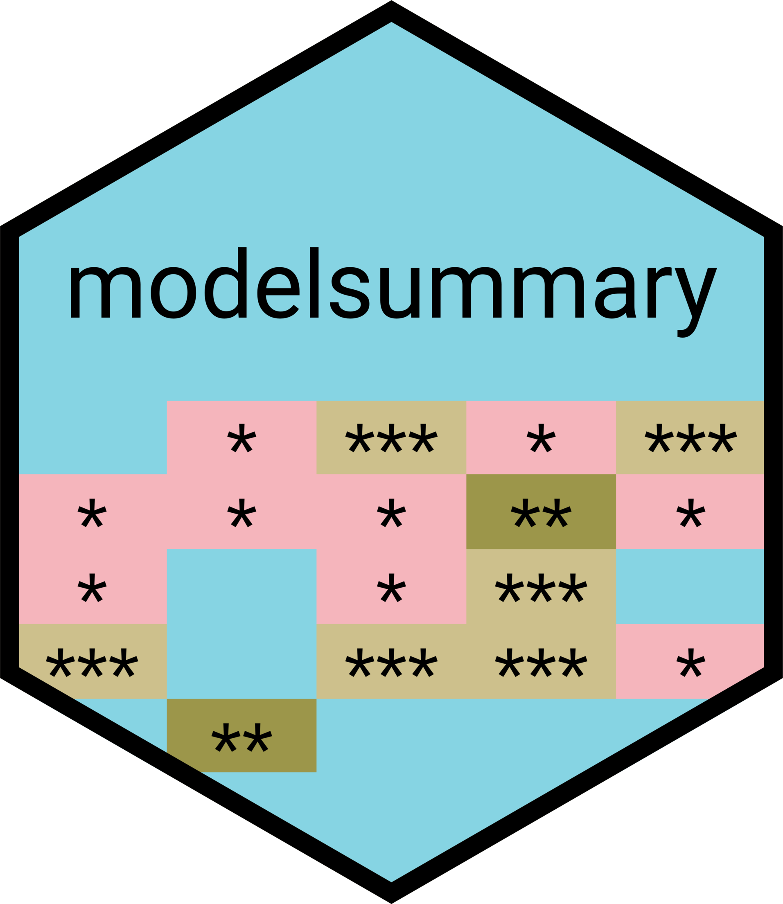
</div>
]


---
# Creating regression tables with modelsummary()

.pull-left[

- `modelsummary()` takes one or several models as input. Multiple models are provided as (optionally named) list.
- The extraction of information (estimates, standard errors, model summaries etc.) is taken care of by the function.
- On this slide you see how `modelsummary()` generates content ready to be rendered as HTML table. With the `output` argument, we can also ask the function to create `.tex`, `.rmd`, `.txt`, `.png`, and `.jpg`.
- Although the defaults are good, be sure to refine the table before publishing it.

]

.pull-right[

```{r, echo = FALSE}
model1_out <- lm(arr_delay ~ dep_delay, data = flights)
model2_out <- lm(arr_delay ~ distance, data = flights)
model3_out <- lm(arr_delay ~ dep_delay + distance, data = flights)
```

```{r}
modelsummary(list(model1_out, model2_out, model3_out), 
             output = "gt")
```

]

---
exclude: true

# Modifying regression tables

.pull-left-vsmall[

- Here's one example for that.
- With `estimate` we define a [`glue`](https://glue.tidyverse.org/reference/glue.html) string to display estimates alongside confidence intervals.
- We suppress uncertainty statistics with `statistic`.
- We omit any goodness-of-fit stats with `gof_omit` and a regular expression.
- We provide a `title`.
]

.pull-right-vwide[

```{r, echo = TRUE, eval = TRUE}
# estimate three toy models
model1_out <- lm(arr_delay ~ dep_delay, data = flights)
model2_out <- lm(arr_delay ~ distance, data = flights)
model3_out <- lm(arr_delay ~ dep_delay + distance, data = flights)
models <- list(model1_out, model2_out, model3_out)

# create table
modelsummary(models, 
             estimate = "{estimate} [{conf.low}, {conf.high}]",
             statistic = NULL,
             gof_omit = ".+",
             title = "Linear regression of flight delay at arrival (in mins)",
             output = "gt") 
```
]

---
# Modifying regression tables

.pull-left-wide[
The `modelsummary()` function is extremely versatile. The defaults are good, but it will pay off to invest some time to learn the details, which are documented [here](https://vincentarelbundock.github.io/modelsummary/articles/modelsummary.html).

In addition, it supports other table-making packages to further customize the appearance of tables. The details are documented [here](https://vincentarelbundock.github.io/modelsummary/articles/appearance.html).

But I don't want to force anything on you. As always in R, there are several other excellent packages that help to create tables, including:

- `gtsummary` by [Daniel Sjoberg](http://www.danieldsjoberg.com/gtsummary/)
- `textreg` by [Philip Leifeld](https://cran.r-project.org/web/packages/texreg/index.html)
- `stargazer` by [Marek Hlavac](https://cran.r-project.org/web/packages/stargazer/index.html)
- `sjPlot` by [Daniel Lüdecke](https://strengejacke.github.io/sjPlot/)

In any case, do invest some time in learning the function's options and in actually producing readable and informative tables before publishing them. (1-3 hours per table are fine!)
]

.pull-right-small[
```{r, eval = FALSE}
modelsummary(
  models,
  output = "default",
  fmt = 3,
  estimate = "estimate",
  statistic = "std.error",
  vcov = NULL,
  conf_level = 0.95,
  stars = FALSE,
  coef_map = NULL,
  coef_omit = NULL,
  coef_rename = NULL,
  gof_map = NULL,
  gof_omit = NULL,
  group = term ~ model,
  group_map = NULL,
  add_rows = NULL,
  align = NULL,
  notes = NULL,
  title = NULL,
  escape = TRUE,
  ...
)
```
]


---
# modelsummary() tables: more examples

.pull-left-center[
<div align="center">
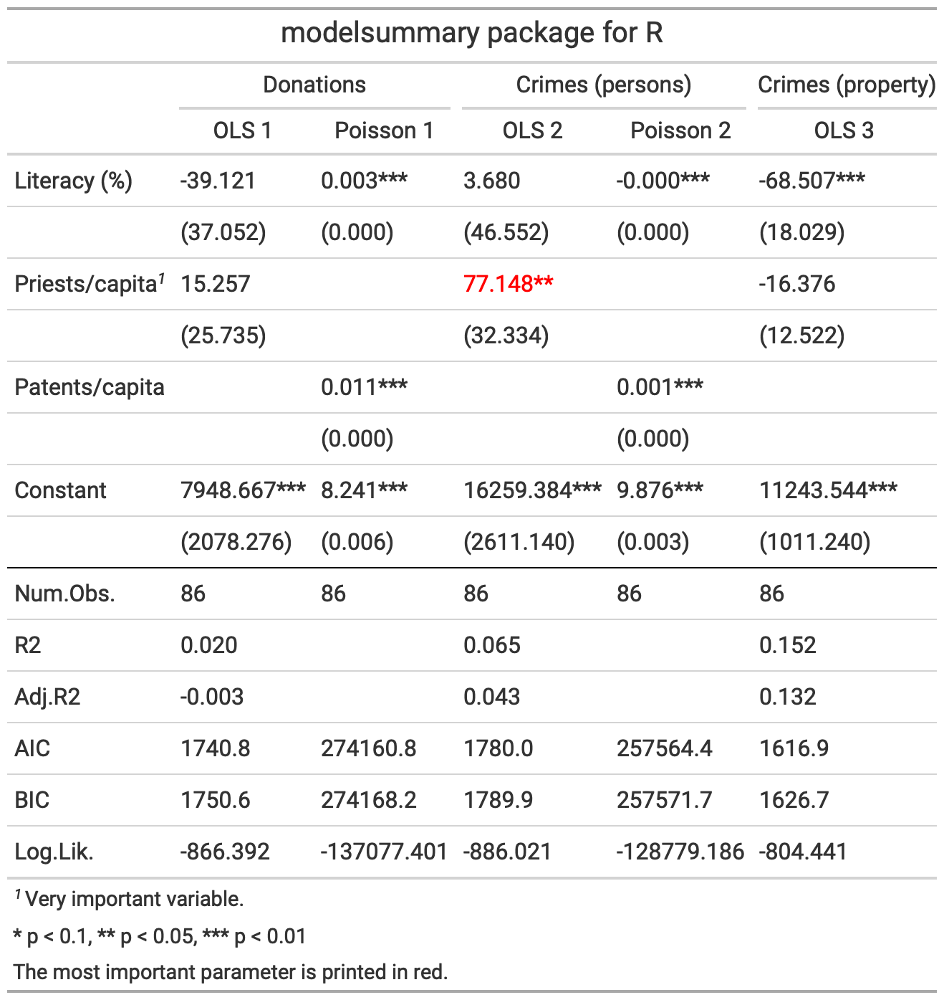
</div>
]

.pull-right-center[
<div align="center">
<br><br>
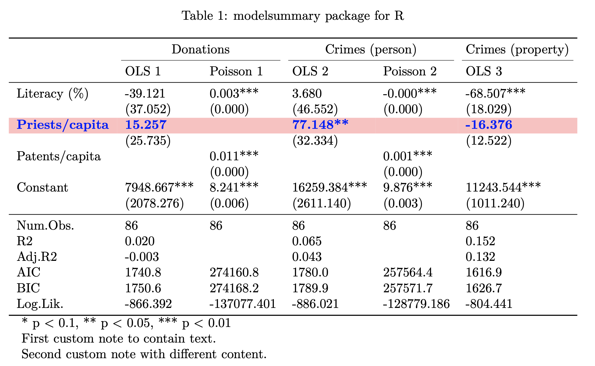
</div>
]


---
# Tables vs. plots to communicate model results

.pull-left[
### The limits of tables

- Tables of coefficients work ok when models are linear and additive.
- They are good to communicate "precise" information.<sup>1</1>
- They are, however, less informative for
  - non-linear relationships between $x$ and $y$ ( $x^2$, $log(x)$, etc.),
  - interaction effects,
  - models for categorical data.
  ]
  
.pull-right[
### The promise of plots 

- *Coefficient plots* can make it more straightforward to focus on two key features of estimated parameters: effect size and uncertainty. 
- What's more, they make comparisons across effects and models much easier. We humans are visual animals.
- Other plots can go a long way to display other implications of models that are not visible from a tabular output, e.g., *predicted probability plots*, *marginal effects plots*, ...
]

.footnote[<sup>1</sup> But sometimes give more precision than warranted. As a rule of thumb, never report more than three decimal points. In most cases, 0-2 is enough. Your estimates are less precise than that anyway.]


---
# Coefficient plots in the wild

.pull-left-center[
<br>
<div align="center">
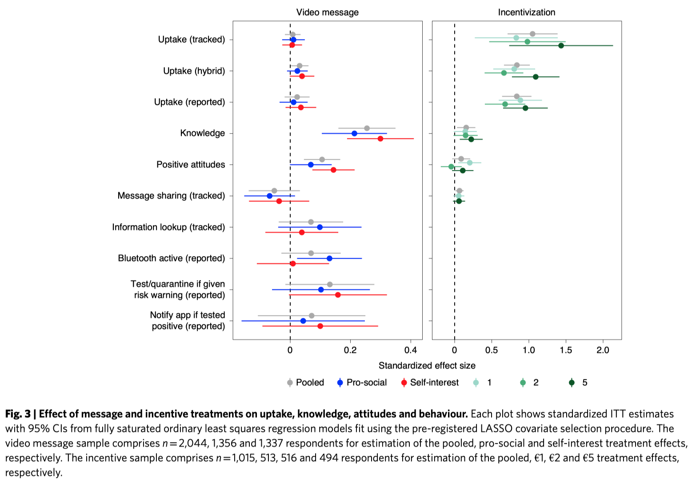
</div>
`Credit` [Munzert et al. 2020](https://www.nature.com/articles/s41562-020-01044-x)
]

.pull-right-center[
<div align="center">
<br><br><br>
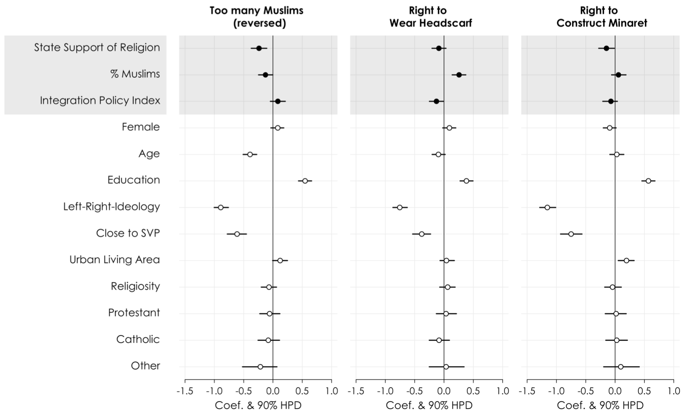
</div>
`Credit` [Helbling and Traunmüller 2016](https://journals.sagepub.com/doi/10.1177/0010414015612388)

]


---
# Creating coefficient plots with modelplot()

.pull-left-small[
- `modelplot()` takes one or several models as input. Multiple models are provided as (optionally named) list.
- Again, the extraction of information (estimates, standard errors, model summaries etc.) is taken care of by the function.
- The graphs produced by `modelplot()` are simple `ggplot2` objects. They can be post-processed (and exported) accordingly.
- Although the defaults are good, be sure to refine the plot before publishing it.
]

.pull-right-wide[
```{r, out.width = "450px"}
modelplot(model_out)
```
]

---
# Modifying coefficient plots


.pull-left-vsmall[

- Here's one example for that.
- We provide intuitive variable names with `coef_map`.
- We drop the intercept with `coef_omit`.
- We make more layout adaptations with `ggplot2` functions that make the plot better readable.
]

.pull-right-vwide[

```{r, echo = TRUE, eval = TRUE, out.width = "550px", fig.height = 2}
cm <- c("distance" = "Distance", 
        "originLGA" = "Origin: LGA", 
        "originJFK" = "Origin: JFK")
modelplot(model_out, 
          coef_omit = "Interc", 
          coef_map = cm) + 
  xlim(-5, .25) + 
  geom_vline(xintercept = 0, linetype="dashed") + 
  labs(title = "Linear regression of flight delay at arrival (in mins)",
       caption = "Data source: nycflights13 package") + 
  theme_minimal()
```
]

---
# Working with interpretable effect sizes

.pull-left[
### Take care when plotting effect sizes

- One of the major perks of coefficient plots is the comparability of effects across coefficients.
- This can be, however, also one of the major problems of these kinds of plots.
- In order for them to make visual sense, the underlying covariates have to be inherently comparable. By showing slopes, the plot shows the effect of a unit change in each covariate on the outcome, but unit changes may not be comparable across variables.
- Also check out the documentation of the [`effectsize` package](https://easystats.github.io/effectsize/) for a more thorough discussion of the problem (and how to tackle it).
]

.pull-right[
### Addressing the issue

- There are several ways to address the problem, including:
  - Rescale variables to show intuitive unit changes in X (e.g., 1km instead of 1m)
  - Rescale to full scale (minimum to maximum) changes in X
  - Standardize variables to show standard deviation changes in X
- Note that any rescaling operation also affects how you interpret the coefficients (and we're only talking about the linear case!). Sometimes it also makes sense to standardize the response variable. In that case, the coefficients can be interpreted as the change in the response in standard deviations for a 1 unit change in the predictor (whatever that is).
]

---
# Working with interpretable effect sizes (cont.)

.pull-left[

**Rescaling (1 unit = 1000 miles)** 

```{r, echo = TRUE, eval = FALSE, out.width = "350px", fig.height = 2}
# rescale continuous variable
flights$distance1kmiles <- flights$distance/1000
model_out_kmiles <- lm(arr_delay ~ 
       distance1kmiles + origin, data = flights)

# plot model (detailed fine-tuning not shown)
modelplot(model_out_kmiles)
```

```{r, echo = FALSE, eval = FALSE, out.width = "550px", fig.height = 2}
# rescale continuous variable
flights$distance1kmiles <- flights$distance / 1000
model_out_kmiles <-lm(arr_delay ~ distance1kmiles + origin, data = flights)
cm <- c("distance1kmiles" = "Distance (1k miles)",
        "originLGA" = "Origin: LGA",
        "originJFK" = "Origin: JFK")

# one model, one plot (more options)
modelplot(model_out_kmiles, coef_omit = "Interc", coef_map = cm) + 
  xlim(-5, .25) + 
  geom_vline(xintercept = 0, linetype="dashed") + 
  labs(title = "Linear regression of flight delay at arrival (in mins)",
       caption = "Data source: nycflights13 package") + 
  theme_minimal()
```

<div align="center">
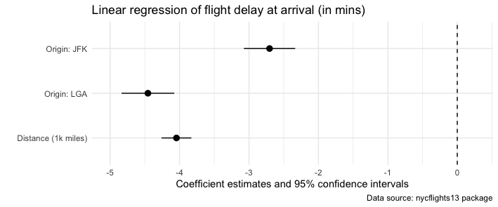
</div>

]

.pull-right[
**Standardization (1 unit = 1 s.d. on the covariate)** 

```{r, echo = TRUE, eval = FALSE, out.width = "350px", fig.height = 2}
# rescale continuous variable
flights$distance_std <- standardize(flights$distance)
model_out_std <- lm(arr_delay ~ 
       distance_std + origin, data = flights)

# plot model (detailed fine-tuning not shown)
modelplot(model_out_std)
```

```{r, echo = FALSE, eval = FALSE, out.width = "350px", fig.height = 2}
# standardized continuous variable
flights$distance_std <- effectsize::standardize(flights$distance)
model_out_std2 <-lm(arr_delay ~ distance_std + origin, data = flights)
cm <- c("distance_std" = "Distance (standardized)",
        "originLGA" = "Origin: LGA",
        "originJFK" = "Origin: JFK")

# one model, one plot (more options)
modelplot(model_out_std2, coef_omit = "Interc", coef_map = cm) + 
  xlim(-5, .25) + 
  geom_vline(xintercept = 0, linetype="dashed") + 
  labs(title = "Linear regression of flight delay at arrival (in mins)",
       caption = "Data source: nycflights13 package") + 
  theme_minimal()
```

<div align="center">
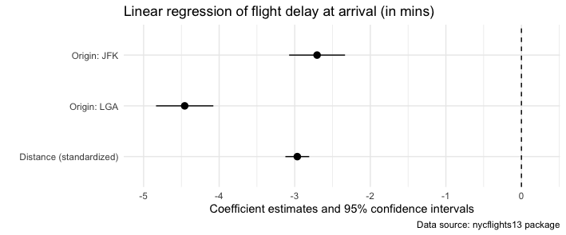
</div>
]


---
# More reporting with plots

.pull-left[
- There is much, much more that can be done with plots and model reporting (stay tuned for the session on visualization!).
- Always be aware about what a model gives you and which relationships you want to explore or highlight.
- As another example, see the fitted vs. true plots on the right. The upper scatter plot compares fitted (x-axis) vs. true (y-axis) values from our standard model. It illustrates a really poor fit.
- The lower scatter plot compares fitted-vs-true for a slight modification of our standard model in which we also take `dep_delay` into account as predictor. Apparently, its a very powerful one.
]

.pull-right[
<div align="center">
<br>
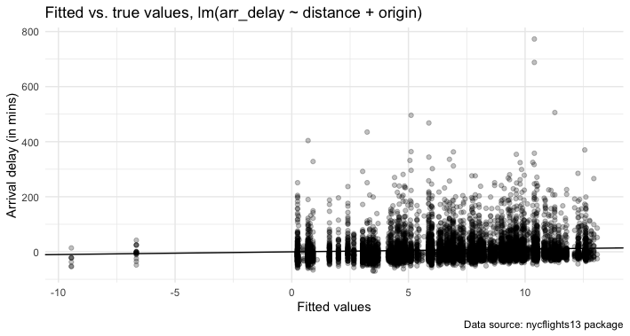
<br>
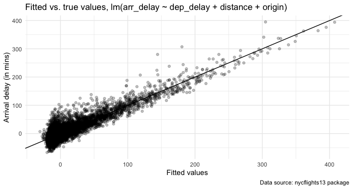
</div>
]


<!-- ############################################ -->
---
class: inverse, center, middle
name: manymodels

# Bonus: Fitting many models

<html><div style='float:left'></div><hr color='#EB811B' size=1px style="width:1000px; margin:auto;"/></html>


---
# Decisions in the modeling workflow
.pull-left[

### Big data and the need for models

- In the early days of the big data hype, people were overly enthusiastic about its implications for modeling (see quote on the right).
- This is falling for the inception that we can simply "let the data speak".
- However, the data science workflow is a sequence of subjective decisions from start to finish, [with lots of researcher degrees of freedom](https://www.pnas.org/doi/suppl/10.1073/pnas.2203150119).
- Think of all the weakly justified decisions regarding:
  - data collection / selection
  - measurement
  - model choice
  - model specification
  - reporting
]

.pull-right[

<br><br>

<div style="background-color:rgba(0, 0, 0, 0.1)">
"Scientists are trained to recognize that correlation is not causation, that no conclusions should be drawn simply on the basis of correlation between X and Y. (...) Once you have a model, you can connect the data sets with confidence. Data without a model is just noise. (...) There is now a better way. Petabytes allow us to say: "Correlation is enough." We can stop looking for models. We can analyze the data without hypotheses about what it might show."
</div>

 *Chris Anderson*, ["The End of Theory: The Data Deluge makes the Scientific Method Obsolete (2008, *Wired*)"](https://www.wired.com/2008/06/pb-theory/)

]


---
# Decisions in the modeling workflow
.pull-left[

### Big data and the need for models

- In the early days of the big data hype, people were overly enthusiastic about its implications for modeling (see quote on the right).
- This is falling for the inception that we can simply "let the data speak".
- However, the data science workflow is a sequence of subjective decisions from start to finish, with lots of researcher degrees of freedom.
- Think of all the weakly justified decisions regarding:
  - data collection / selection
  - measurement
  - model choice
  - model specification
  - reporting
  
**Question:** How do researchers usually deal with this?
]

.pull-right[

<br><br>

<div style="background-color:rgba(0, 0, 0, 0.1)">
"Scientists are trained to recognize that correlation is not causation, that no conclusions should be drawn simply on the basis of correlation between X and Y. (...) Once you have a model, you can connect the data sets with confidence. Data without a model is just noise. (...) There is now a better way. Petabytes allow us to say: "Correlation is enough." We can stop looking for models. We can analyze the data without hypotheses about what it might show."
</div>

 *Chris Anderson*, ["The End of Theory: The Data Deluge makes the Scientific Method Obsolete (2008, *Wired*)"](https://www.wired.com/2008/06/pb-theory/)

]


---
# Nested models

.pull-left-center[
<div align="center">
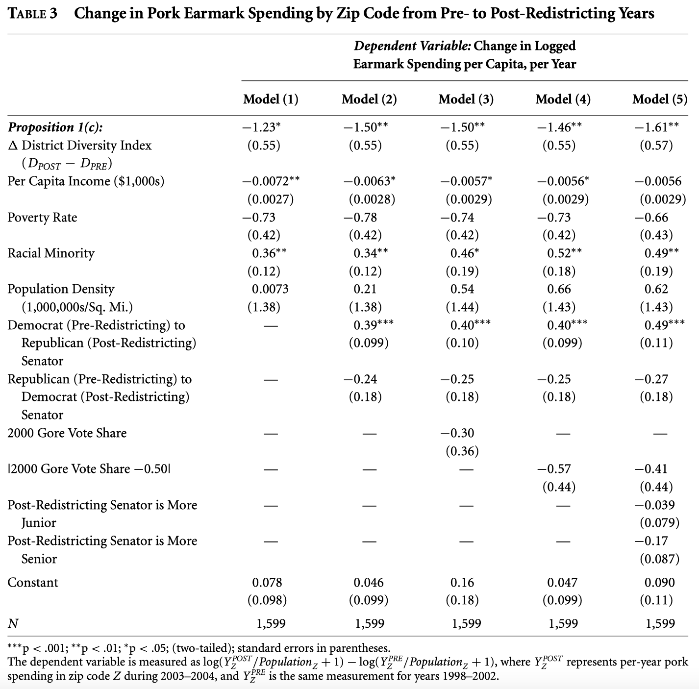
</div>
`Credit` Chen 2010, [The Effect of Electoral Geography on Pork Barreling in Bicameral Legislatures](https://www.jstor.org/stable/25652208)
]

.pull-right-center[
<div align="center">
<br><br>

</div>
`Credit` Park et al. 2009, [Being immersed in social networking environment: Facebook groups, uses and gratifications, and social outcomes](https://pubmed.ncbi.nlm.nih.gov/19619037/)
]


---
# Exploring the model space

.pull-left[

- **Another idea:** run not an arbitrary (small) set of models but as many (plausible ones) as possible to get an idea how much conclusions change depending on arbitrary data wrangling and modeling choices (the "model distribution").
- There are various related procedures and labels used in different subfields to promote this idea, including:
  - Multiverse analysis ([Steegen et al. 2016](https://journals.sagepub.com/doi/10.1177/1745691616658637))
  - Specification curves ([Simonsohn et al. 2020](https://www.nature.com/articles/s41562-020-0912-z))
  - Computational multimodel analysis ([Young and Holsteen 2015](http://fmwww.bc.edu/repec/bocode/m/Model_Uncertainty_and_Robustness.pdf))
- Also check out critical perspective on "[Mülltiverse Analysis](http://www.the100.ci/2021/03/07/mulltiverse-analysis/)" (Julia Rohrer). The bottom line: Mindless multiversing doesn't give more robustness or insight.
]

.pull-right[
<div align="center">
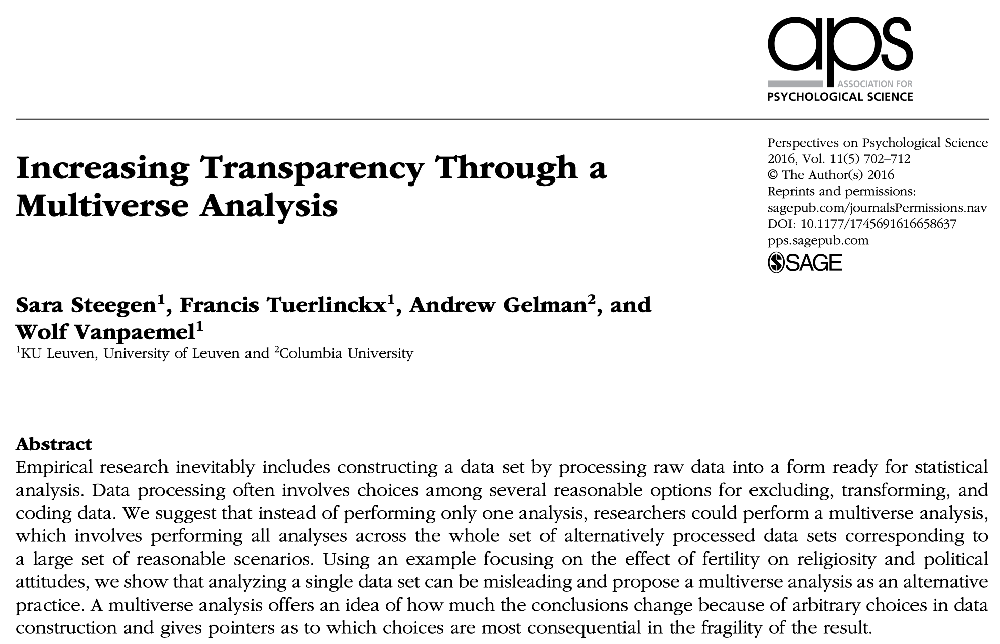
<!--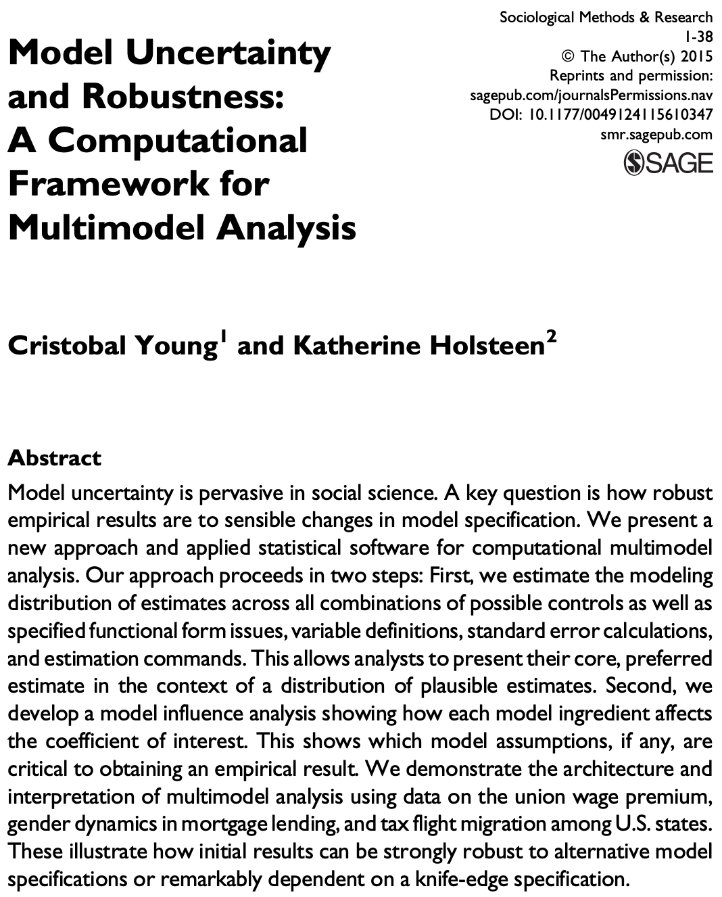-->
</div>
]


---
# Specifying multiple models

.pull-left[
### When one model is not enough

- Often we want to specify not one but multiple models. They can differ in model family, outcome, covariate set, transformations, or data.
- If outcomes/features vary, so does the formula. Treating formulas as strings, we can generate them programmatically:

```{r, eval = TRUE}
xvars <- paste0("x", 1:10)
as.formula(paste("y ~", paste(xvars, collapse = " + ")))
```
]

.pull-right[
### Example: extreme bounds analysis

- [Extreme bounds analysis (EBA)](https://en.wikipedia.org/wiki/Extreme_bounds_analysis) estimates models with *all* combinations of a set of covariates and looks at the distribution (or range: the extreme bounds) of a coefficient across them.
- Which determinants are robustly associated with the outcome, whatever else is in the model?
- There are packages for this (`ExtremeBounds`), but the basics are easy to build ourselves.

**Step 1: Define outcome and covariate set**

```{r, eval = TRUE}
depvar <- "arr_delay"
covars <- c("dep_delay", "carrier", "origin",
            "air_time", "distance", "hour")
```

That's 63 possible non-empty subsets of covariates, hence 63 models.
]


---
# Specifying multiple models (cont.)

**Step 2: Build function to run lm models across set of all possible variable combinations **

```{r, eval = TRUE}
combn_models <- function(depvar, covars, data)
{
  combn_list <- list()
  # generate list of covariate combinations
  for (i in seq_along(covars)) {
    combn_list[[i]] <- combn(covars, i, simplify = FALSE)
  }
  combn_list <- unlist(combn_list, recursive = FALSE)
  # function to generate formulas
  gen_formula <- function(covars, depvar) {
    form <- as.formula(paste0(depvar, " ~ ", paste0(covars, collapse = "+")))
    form
  }
  # generate formulas
  formulas_list <- purrr::map(combn_list, gen_formula, depvar = depvar)
  # run models
  models_list <- purrr::map(formulas_list, lm, data = data)
  models_list
}
```


---
# Specifying multiple models (cont.)

**Step 3: Run the models** (on a 10,000-flight sample; the full data makes a heavy list)

```{r, eval = TRUE, echo = FALSE, include = FALSE}
models_list <- combn_models(depvar = depvar,  covars = covars, data = sample_n(flights, 10000))
length(models_list)
models_list[[1]]
```

```{r, eval = FALSE}
models_list <- combn_models(depvar = depvar,  covars = covars, data = flights)
```

How many models did we fit?

```{r, eval = TRUE}
length(models_list)
```

And what did we get? A glimpse at the first list element:

```{r, eval = TRUE}
models_list[[1]]
```


---
# Evaluating many models with broom

**Step 4: Extract tidy results from all models and stack them** (this is where `broom` shines)

```{r, eval = TRUE}
models_broom_df <- map(models_list, tidy) |> list_rbind(names_to = "model")
```

**Step 5: Summarize the estimates for key predictors**

```{r, eval = TRUE, fig.height = 1.25}
models_broom_df |>
  filter(!str_detect(term, "Intercept|carrier")) |>
  ggplot(aes(estimate)) +
  geom_histogram(binwidth = .1, color = "red") +
  geom_vline(xintercept = 0, linetype = "dashed") +
  facet_grid(cols = vars(term), scales = "free_y")
```


---
# Specification curve analysis

.pull-left[

- **Specification curve analysis** (SCA; [Simonsohn, Simmons and Nelson 2020](https://www.nature.com/articles/s41562-020-0912-z)) formalizes the idea: instead of reporting one (or a few) arbitrarily chosen specifications, report *all reasonable* ones.
- Three main steps:
  1. **Define** the set of reasonable specifications;
  2. **Estimate** all of them and report the results in a *descriptive specification curve*;
  3. **Test** the results jointly using an *inferential specification curve*.
- What counts as "reasonable"? A specification should be **theoretically justified** (a sensible test of the hypothesis), **statistically valid** (not obviously misspecified), and **non-redundant** with the others in the set.
]

.pull-right[
<div align="center">
<br>
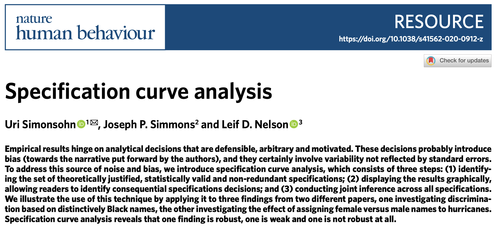
<br>
<br>
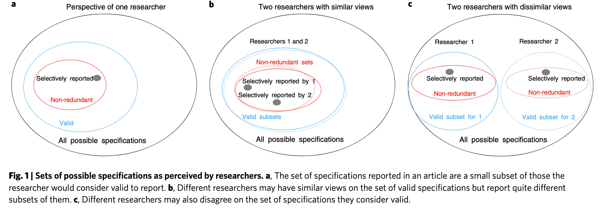
</div>
]


---
# Specification curve analysis (cont.)

.pull-left[

### The descriptive curve

- All estimates sorted by effect size, significance highlighted, plus a dashboard underneath showing which decisions went into each specification.
- Reveals *which* decisions drive the results, e.g., whether an effect only appears when a certain control is excluded.

### The inferential curve

- How extreme is the observed curve if the true effect were zero?
- Simulate the null by resampling with the effect of interest removed, re-run all specifications on each resample, and compare.
- Three joint test statistics: **median effect size**, **share of significant specifications**, **aggregate z** (Stouffer).
]

.pull-right[

### In practice

- Example in the paper: are hurricanes with female names deadlier? Across 1,728 reasonable specifications, only about a third of the estimates are significant; the joint tests fail to reject the null.
- R packages: `specr` (see [here](https://masurp.github.io/specr/)) and `multiverse` (see [here](https://mucollective.github.io/multiverse/)).
- The building blocks are what we just did: generate formulas programmatically, fit models with `map()`, collect results with `broom`.
- Caveat: SCA does not free you from thinking. The set of specifications has to be defined *ex ante* and justified. Padded with implausible models, the curve is meaningless ("Mülltiverse").
]


---
# Specification curves in the wild

<div align="center">
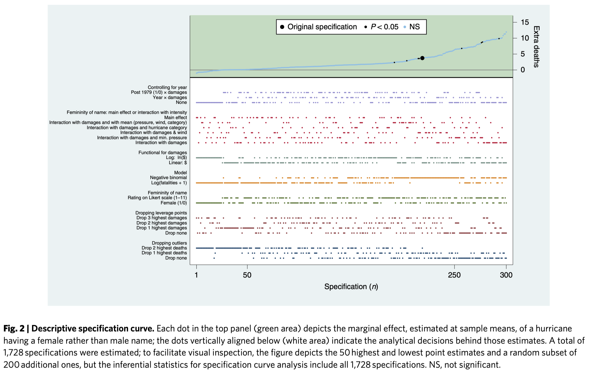
</div>


---
# Summary

Some final bits of advice that didn't fit on the main slides:

1. Before you actually run models, **describe the data**. That's not only for you. Every report should begin with a visualization of the phenomena of interest, plotting the rawest data available that is also legible in a graph.

2. **Plot early, and plot often**! Visualization is not only a great tool for communication, but also for exploration and statistical analysis (more on that later).

3. **Fit many models**. At least if you don't commit to one particular subset (→ preregistration). Think in terms of series of models, starting with the utterly simple and continuing through to the hopelessly complex.

4. **Never judge a model on the data it was trained on**. Split first, resample to compare and tune, touch the test set once.

5. **Table results with care**. Please don’t just report which effects were significant and which were non-significant. Please don’t report just p-values. Please don’t just report the estimated effects of the significant effects. Report all estimates that you also discuss.

6. **Invest more time in refining plots** than you planned to. Good figures aren't only plots. Think of informative headers and notes. Ideally, your figures are self-contained.


